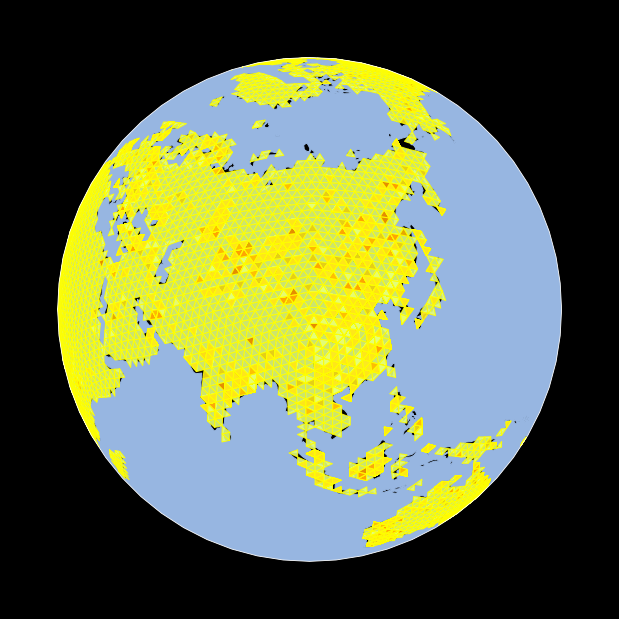
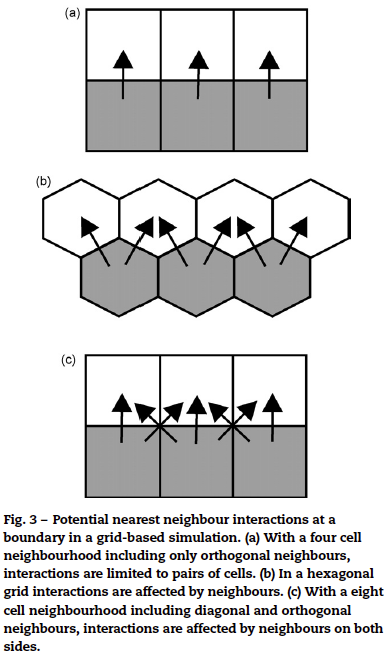
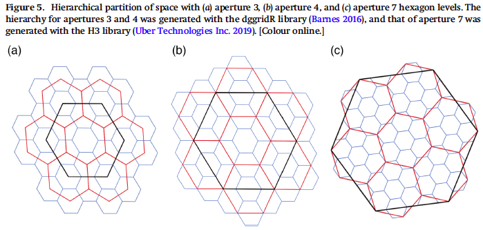

## Overview

TranquilCity (TC) is looking into scaling its air and noise pollution indices worldwide. The gridding method used so far is based on their own 20 x 20 m grid which rationale derives from the grid of the air quality modelling data. Thus, the process of assigning metrics to streets starts with the 20 x 20 m grid, the highest resolution, and then data is joined to the street segments or park paths (areas). Some key points and questions arising are:

1.  How can TC adopt a griding system that allows scaling their analysis worldwide? How would different regions (cities) be connected together?
2.  How can TC's data be shared with other users in a universal way? How is their data interoperable with other data?
3.  What are the specific limitations of creating their own grid system? e.g. geographic extent vs processing time at the expense of losing spatial resolution
4.  Besides the Uber's H3 and Whatthreewords grid, what other grid systems are available and relevant?

This notebook first reviews the nature of spatial grids, then it outlines a brief description of existing grid systems and finally concludes with final comments and recommendations.

## Spatial grids

Grids are frequently used to study physical space, for observations (collecting data), experiments and simulations (modelling). In spatial analysis grids are often defined to sample, index, or partition a study area.

Even though for TC the main purpose is to create and indexing solution, the statements below reveal useful concepts for the definition of a grid system. More advanced tools and techniques for spatial analysis can be found in the chapter 'Building Blocks of Spatial Analysis' from [Geospatial Analysis 6th Edition, 2021 update](https://spatialanalysisonline.com/HTML/index.html).

Grids can be classified as irregular and regular. Both follow the same principle of dividing a region into a set of non-overlapping areas. A common method for subdividing space from existing point observations is the Voronoi tessellation (which is the dual of a [Delaunay triangulation](https://miro.medium.com/max/1400/1*LI-z6a73mRYupGMQs9Ar2Q.gif), see figures below) and creates irregular cells based on the **distance** between points (panel B in Fig.1b).

{width="500"} 

{width="500"}

Another typical approach in Geographic Information Systems is the creation of regular grids. "The rectangular grid is generally preferred because of its symmetrical, orthogonal co-ordinate system and the frequent use of rasters". "Remotely sensed data are stored as pixels in regular lattices. Thus, regular lattices are important for experimental and observational science, as well as providing the most common framework for spatially explicit models" [^1]. Mathematically reasoning yields only [3 regular tessellations of a plane](https://en.wikipedia.org/wiki/List_of_regular_polytopes_and_compounds#Euclidean_tilings): Square tilling, Triangular tilling and Hexagonal tilling. The following section reviews existing grid systems commonly used for spatial applications.

[^1]: Birch, C.P.D., Oom, S.P. and Beecham, J.A. (2007) 'Rectangular and hexagonal grids used for observation, experiment and simulation in ecology', Ecological Modelling, 206(3), pp. 347--359. doi:10.1016/j.ecolmodel.2007.03.041.

## Existing grid systems

Overview of grid systems published by different agencies. The following area reviewed below:

- what3words

- Uber H3

- OpenEAGGR

- Quarter Degree Grid Cell System

- Free and open-source software (FOSS) grid

### what3words

Is as proprietary geocode system that divides the world surface into 3 x 3 m squares grid creating 57 trillion cells. The motivation for its creator is that he "struggled to get bands and equipment to music venues using inadequate address information... he tried using GPS coordinates to locate the venues, but decided that words were better than numbers after a one-digit error led him to the wrong location" [^2]. Each cell is encoded by a set of 3 words from the English dictionary (e.g. the South-east corner of the eastern fountain in Trafalgar square corresponds to [vivid.cling.result](https://what3words.com/vivid.cling.result). The interactive overlay of the 3 x 3 m gird on GoogleMaps below shows the level of detail displayed at each cell.

[^2]: From wikipedia: [what3words](https://en.wikipedia.org/wiki/What3words#:~:text=What3words%20divides%20the%20world%20into,are%20available%20in%2050%20languages.)

<iframe src="https://fobvp.csb.app/" style="width:100%; height:500px; border:0; border-radius: 4px; overflow:hidden;">

</iframe>

Different industry applications are advertised, including the private and public sectors from the automotive and UAVs to humanitarian and government. An API and developers solutions are offered for the integration with other platforms.

### Uber H3

This grid system was developed by UBER for operational and analytical purposes[^3]

[^3]: From [Uber Engineering](https://eng.uber.com/h3/)

-   Operational: for efficiently optimizing ride pricing and dispatch
-   Analytical: for visualizing and exploring spatial data

A key characteristic of the H3 system is its hierarchical structure. This means that cells can be (dis)aggregated to almost any level and down to a square meter resolution (569,707,381,193,162 cells \~ 570 trillion). Again the rationale behind the hierarchical structure is analytical efficiency. Uber's explanation well illustrates this: "Deriving information and insights... requires analysing data across an entire city. Because cities are geographically diverse, this analysis needs to happen at a fine granularity. Analysis at the finest granularity, the exact location where an event happens, is very difficult and expensive. Analysis on areas, such as neighbourhoods within a city, is much more practical". The example pictured below is a common case of summarising points data in spatial analysis for the identification of patterns.

{width="600"}

This grid system has been developed into a collaborative project (see H3 GitHub [page](https://github.com/uber/h3)) under an Apache License 2.0 which is described as a "permissive license whose main conditions require preservation of copyright and license notices. Contributors provide an express grant of patent rights. Licensed works, modifications, and larger works may be distributed under different terms and without source code".

### OpenEAGGR (Open Equal Area Global GRid)

This system is a software library that implements a Discrete Global Grid System (DGGS), modelling the surface of the earth into equal area cells of up to an area one square centimetre. This system was developed by a security consultancy [Riskaware](https://www.riskaware.co.uk/innovation-hub/) and has a GitHub [repository](https://github.com/riskaware-ltd/open-eaggr). The documentation is less comprehensive but it can be inferred that it implements the [Snyder Equal Area Projection](https://en.wikipedia.org/wiki/Snyder_equal-area_projection) to map points into an icosahedron model of the Earth obtaining both a triangular (ISEA4T) and an hexagonal (ISEA3H) system partition.

{width="300"} 

{width="500"}

This [notebook](https://nbviewer.org/github/allixender/30MapChallenge2020/blob/main/08/day-08.ipynb) shows the implementation of the ISEA4T using GeoPandas and [DGGRID](https://github.com/sahrk/DGGRID), a free software program for creating and manipulating Discrete Global Grids, with the map below as result.

{width="500"}

### Quarter Degree Grid Cell System

This system is most common in African applications. It takes longitude and latitude degree square cells and divides them into smaller squares. For example the location of 28°30'00.0"S 30°30'00.0"E can be noted as QDGC 2830CB.

{width="300"}

### Free and open-source software (FOSS) grid

According to this [GIS StackExchange QA](https://gis.stackexchange.com/questions/358382/is-there-a-foss-implementation-for-discrete-global-grid-system-global-statisti), there is not yet an Free Open Source Software (FOSS) implementation for a Discrete Global Grid System (DGGS). Reference is given about two standards; [OGC - Open Geospatial Consortium](https://docs.opengeospatial.org/as/15-104r5/15-104r5.html) and [Inspire - Infrastructure for Spatial Information in Europe](Ihttps://inspire.ec.europa.eu/documents/Data_Specifications/INSPIRE_DataSpecification_GG_v3.1.pdf). Reference is also given about the [S2](https://s2geometry.io/) which might be considered similar to QDGC as it divides the earth sphere and represents all data on three-dimensions. 

The paper 'Assessing the state of the art in Discrete Global Grid Systems: OGC criteria and present functionality'[^4] seems to conclude that H3 is the closest followed by S2.

The [DGGRID](https://www.discreteglobalgrids.org/) project from the Southern Oregon University has an important number of relevant resources and is refer as a possible FOSS solution. Among the DGGRID users [OpenStreetMap History eXplorer](https://hex.ohsome.org/) stands out.

[^4]: Bondaruk, B., Roberts, S.A. and Robertson, C. (2020) ‘Assessing the state of the art in Discrete Global Grid Systems: OGC criteria and present functionality’, Geomatica, 74(1), pp. 9–30. doi:10.1139/geomat-2019-0015.

## Conclusions and recommendations

According to the information reviewed it is clear that for the purposes of scaling TC's methodology in an efficient and interoperable way a number of solutions are easily and accessible and most commonly free. From these and given the advantages (and popularity of its implementation) an hexagon-based grid is recommended and would work for both summarising data at a convenient resolution and sharing the information. Additionally, although not yet discussed, it has been shown that hexagonal grids outperform square grids when conducting more advanced spatial analysis, in particular network analysis due to its lesser ambiguity in the identification of neighbours (in regular hexagons grids all neighbours are identical each sharing one of the six equal length sides of the cells and with centroids at equal distance).

Both the Uber H3 and the DGGRID have a number of openly accessible resources for a convenient implementation and integration with other platforms. A recent paper (2020) evaluating the compliance of these libraries against OGC specifications concludes that "the H3 library appears to be the most complete, lacking only criterion 7": Equal area precision. The method of evaluation considered the use of the libraries "as a comprehensive approach for geocoding, addressing, and discretizing of geospatial data, as well as effective ways for its analysis and display". The paper further suggests that "Further work developing operational DGGS that solve real world problems may promote greater community adoption and integration of DGGS data structures into commonly used geospatial platforms". Nevertheless, given the available explicit documentation and continuing development it can be inferred that the H3 grid system is likely to be implemented as the facto system by both the industry and scientific communities.

This [interactive map](https://wolf-h3-viewer.glitch.me/) by [Cristian Lupașcu](https://github.com/clupasq) shows the hierarchical structure and resolution of the H3 grid system.

### Extra resources

[Research into innovative DGGS indexing](https://landscape-geoinformatics.ut.ee/dggs-en)

[Discrete Global Grid Systems presented by OGC](https://www.youtube.com/watch?v=xh5csOiRVsk)

[Spatial Pattern Analysis in Plant Ecology](http://nozdr.ru/data/media/biblio/kolxoz/B/Dale%20M.R.T.%20Spatial%20pattern%20analysis%20in%20plant%20ecology%20(CUP,%201999)(ISBN%200521452279)(337s)_B_.pdf)

[Rectangular and hexagonal grids used for observation, experiment and simulation in ecology](https://www-sciencedirect-com.libproxy.ucl.ac.uk/science/article/pii/S0304380007001949#fig4)

[Discrete Global Grid Systems: Operational Capability of the Current State of the Art](http://ceur-ws.org/Vol-2323/SKI-Canada-2019-7-6-1.pdf)

[Wbmap Tiles - client-side raster reprojection capabilities from OSM (EPSG:3857)](https://openlayers.org/en/latest/examples/reprojection-by-code.html)

